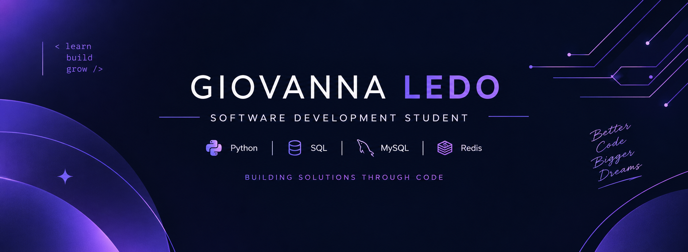

  

# Oi, eu sou a Giovanna 

**Estudante de Desenvolvimento de Software Multiplataforma na FATEC 🇧🇷**
*Transformando problemas do dia a dia em soluções práticas com código.*

[LinkedIn](https://www.linkedin.com/in/giovannaledo) · [Meus projetos](https://github.com/giovannaledo?tab=repositories)

---

## Sobre mim

Gosto de desenvolvimento de software, bancos de dados e de criar soluções que as pessoas realmente usam.

-  Cursando Desenvolvimento de Software Multiplataforma na FATEC
-  Evoluindo em programação e bancos de dados
-  Curiosa por resolver problemas e construir aplicações
-  Aprendendo na prática, projeto a projeto
-  Aberta a estágio e oportunidades iniciais em tecnologia

## O que eu faço por pequenos negócios

Ajudo empresas a vender online e organizar o caixa:

-  Loja virtual para varejo e atacado
-  PDV com leitor de código de barras e integração com maquininha
-  Migração de produtos e treinamento da equipe
-  Planejamento: entendo a sua operação antes de indicar a ferramenta certa

## Tecnologias

**Áreas de interesse:** desenvolvimento web, desenvolvimento de software e modelagem de banco de dados.

## Projetos em destaque

###  SiSGEH: Simulador de Geração Hidrelétrica
Projeto acadêmico que simula a geração de energia hidrelétrica, com parâmetros configuráveis e diferentes cenários de operação.
**Foco:** software educacional, levantamento de requisitos e design de interface.

###  Pousada Pedra Furada
Sistema web de gerenciamento de tarefas para uma pousada.
**Foco:** desenvolvimento web e engenharia de software.
[Ver repositório →](https://github.com/giovannaledo/Pedra-Furada)

## Idiomas

🇧🇷 Português: nativo · 🇺🇸 Inglês: B2 (TOEIC)

## Vamos conversar?

Se você tem um negócio, uma ideia ou uma vaga, fale comigo pelo [LinkedIn](https://www.linkedin.com/in/giovannaledo).

🇺🇸 English summary

I'm Giovanna, a Multiplatform Software Development student at FATEC (Brazil). I work with Python, JavaScript and SQL databases, and I help small businesses set up online stores and point-of-sale systems. Open to internships and entry-level roles.

*Aprendendo construindo. Melhorando a cada projeto.*

[Connect with me on LinkedIn](https://www.linkedin.com/in/giovannaledo)

*Learning by building. Improving with every project.*

__
